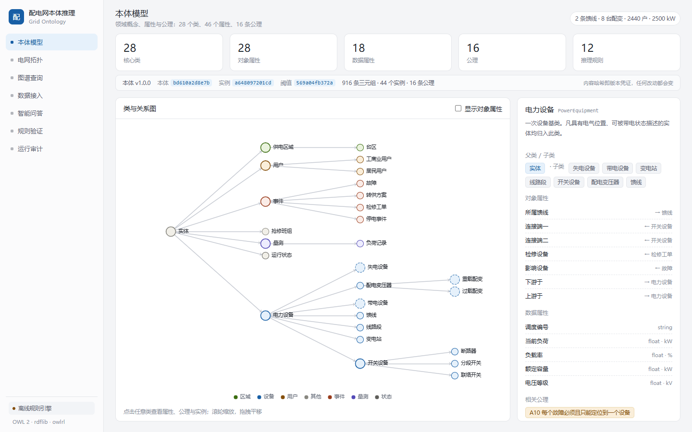
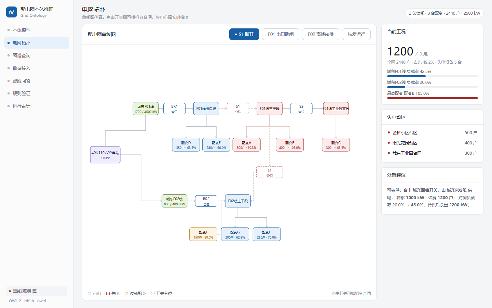
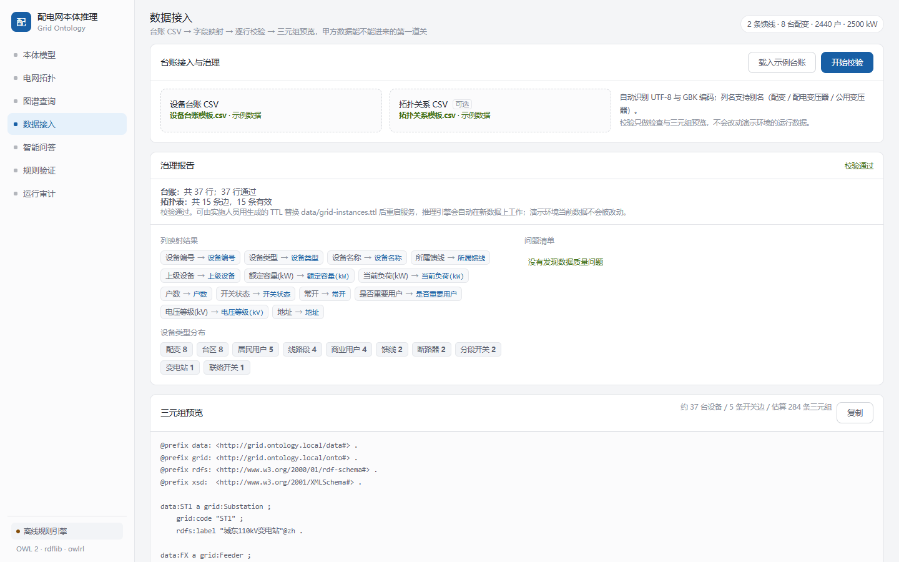
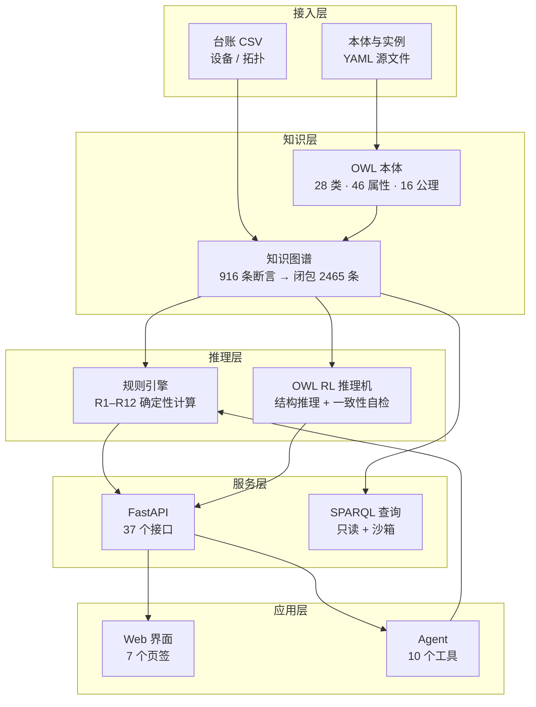

# 配电网本体模型与知识推理

用 OWL 本体建模配电网，用规则引擎做故障推理，用大模型只做自然语言翻译。

输入一个开关动作，输出失电台区、影响户数、转供方案，以及**每一步的推理依据**。

📄 [设计文档](DESIGN.md) · [推理验证报告](docs/推理验证报告.md) · [架构方案评估](docs/架构方案评估与采纳说明.md) · [需求澄清清单](docs/需求澄清清单.md)



---

## 这个项目想说明什么

多数「知识图谱 + 电力」的项目做到最后是一个拓扑展示页：把设备画成节点、线路画成边，点了能看属性。这解释了「电网长什么样」，但回答不了「**所以呢**」。

真正有业务价值的问题是这类：

> S1 分段开关断开，哪些用户会失电？影响多少户？能不能转供？如果 F02 线正在晚高峰呢？

这些问题需要三样东西同时到位，缺一不可：

| 需要什么 | 本项目怎么给 |
|---|---|
| **领域概念的表达能力** | 28 个类、46 个属性、16 条 OWL 公理，类名对齐 IEC 61970 CIM |
| **确定性的计算** | 12 条规则（R1–R12），失电判定、容量校验、转供复核全部是代码算的 |
| **可追溯的解释** | 每个结论都带 trace：用了哪条规则、依据什么数据、得出什么 |

大模型在这里只做一件事：把「S1 跳了会影响谁」翻译成一次工具调用。**所有数字都来自推理引擎，模型不参与计算**——这是电力业务能接受 AI 的前提。

---

## 三个核心场景

**① 故障传播** — 断开 S1，沿闭合开关做广度优先搜索，不可达的设备即为失电。

```
S1 分位 → LS2/LS3 供电路径中断 → 配变 A/B/C 失电 → 3 个台区 1200 户受影响
```

**② 过载判定** — 负载率 = 当前负荷 / 额定容量，阈值可配（默认 100% 过载、80% 重载）。

```
配变 B：420 / 400 = 105% → 过载
```

**③ 转供可行性** — 找一端带电、一端失电的联络开关，模拟合闸后校验对侧容量。

```
合上 L1 → 转移 1000 kW 至 F02 → 对侧 20% → 45% → 余量 2200 kW → 可行，恢复 1200 户
若 F02 晚高峰 3400 kW → 备用仅 600 kW，缺口 400 kW → 不可行
```

同一套规则，只因容量不同就给出相反结论——这就是「不是靠猜」的证据。



---

## 快速开始

```bash
# 1. 安装依赖（Python 3.10+）
pip install -r requirements.txt

# 2. 启动
python run.py

# 3. 浏览器打开
#    http://127.0.0.1:8000
```

Windows 下也可以直接双击 `start.bat`。

**不需要数据库、不需要联网、不需要 API Key。** 默认是离线 mock 模式，推理与数字完全正常，只是自然语言理解换成正则匹配。

接在线或本地大模型时改 `.env`：

```bash
LLM_PROVIDER=openai_compat
LLM_BASE_URL=https://api.deepseek.com/v1    # 在线
LLM_API_KEY=sk-xxxxxxxx
LLM_MODEL=deepseek-chat
```

```bash
# 换成本地部署的模型，只改 base_url，代码一行不动
LLM_BASE_URL=http://127.0.0.1:11434/v1      # Ollama
LLM_BASE_URL=http://127.0.0.1:8000/v1       # vLLM
LLM_BASE_URL=http://127.0.0.1:1234/v1       # LM Studio
```

---

## 七个页面

| 页面 | 做什么 | 解决什么问题 |
|---|---|---|
| **本体模型** | 类层次树、属性、公理、实例 | 我的本体到底建了什么 |
| **电网拓扑** | 单线图，点开关即模拟分合闸 | 断开某台开关会怎样 |
| **图谱查询** | SPARQL 只读查询，8 条示例 | 换一种问法要不要改代码 |
| **数据接入** | 台账 CSV → 校验 → 三元组预览 | 我们自己的数据能不能进来 |
| **智能问答** | 自然语言提问 + 推理链 | 能不能用人话问 |
| **规则验证** | 8 道题预期/实际比对 + 阈值调节 | 结论对不对，标准变了怎么办 |
| **运行审计** | 每次操作的留痕 | 出了问题能不能查 |



---

## 架构



**关键约束**：Agent 不直接读图，只调用推理层的工具。这样模型即使胡说，也编不出数字。

---

## 五个设计决策

| 决策 | 选择 | 代价 / 理由 |
|---|---|---|
| **推理怎么分层** | OWL 管结构，规则引擎管数值 | OWL 不做数值比较和求和，硬用 SWRL 调试成本超过收益 |
| **拓扑存哪** | 只存一份，在 TTL 里 | 代码零硬编码电网结构，改本体即改结论；代价是每次启动都要解析 |
| **开关状态怎么表示** | `OpenState`/`ClosedState` 个体，不用字符串 | 「常态分位」与「当前状态」能分开表达，转供方案的本质才说得清 |
| **阈值放哪** | `data/thresholds.yaml`，运行时可改 | 80%/100% 是演示值不是行业标准，甲方说「我们按 90%」时不用改代码 |
| **要不要上数据库** | 不上，文件 + 内存图 | 84 KB 数据上中间件是负担；到百万级三元组再换 Jena，SPARQL 语句不用改 |

---

## 技术栈

| 层 | 选型 | 说明 |
|---|---|---|
| 本体 | OWL 2 / RDF / RDFS | 源文件用 YAML 写，`build.py` 生成 TTL |
| 图与推理 | rdflib 7.6 + owlrl 7.6 | 916 条显式三元组，OWL RL 闭包后 2465 条 |
| 后端 | FastAPI + Pydantic | 37 个接口，全量类型校验 |
| 前端 | 原生 JS + ECharts | 零构建，无需 npm，双击即用 |
| 大模型 | OpenAI 兼容协议 | 在线 API / vLLM / Ollama / LM Studio 通吃 |
| 测试 | pytest | 95 项，含 8 道端到端推理题 |

---

## 验证结果

不是「跑通了」，是可复现的断言：

```
pytest tests -q                    → 95 passed
python scripts/smoke_api.py        → 37 个接口全 200
python -m app.reasoner.verify      → 8/8 道推理题通过
```

8 道题里有 3 道是边界题（可行转供 / 不可行转供 / 无解场景），专门用来卡住「含糊其辞」：

| 题 | 预期 | 引擎输出 |
|---|---|---|
| S1 断开影响多少户 | 1200 户 | ✅ 金桥 500 + 阳光花园 400 + 城东工业园 300 |
| 能否转供 | 经 L1 转 1000 kW，恢复 1200 户 | ✅ F02 负载率 20%→45% |
| 配变 B 过载怎么处理 | 无备用可切，切负荷 20 kW | ✅ 由基数公理 A5 推出「台区仅一台配变」 |

另有两项独立自检：

- **OWL 一致性**：把规则层结论断言回本体跑闭包，检查同一设备会不会既带电又失电
- **数据接入闭环**：从 CSV 台账重新生成三元组，再跑一遍 8 道题，结果必须一致

---

## 目录结构

```
ontology/
  grid-ontology.yaml      本体源文件（类、属性、公理），人可读可评审
  build.py                YAML → OWL/TTL 生成器 + 结构校验
data/
  grid-instances.yaml     样例电网：2 馈线 / 5 开关 / 8 配变 / 8 台区 / 2440 户
  thresholds.yaml         推理阈值（可现场调）
  templates/              甲方台账 CSV 模板
app/
  reasoner/               推理引擎
    graph.py              TTL → 内存模型（拓扑唯一来源）
    rules.py              R1–R12 规则定义与算法
    engine.py             失电 / 转供 / 过载 / 检修 / 故障 / 一致性
    thresholds.py         阈值容器（校验、运行期覆盖、基线恢复）
    owl.py                OWL 自检 + 推理闭包图
    verify.py             8 道验证题
  ingest/                 数据接入治理（字段映射 / 校验 / 三元组生成）
  agent/                  Agent 编排与 10 个工具
  audit.py                运行审计
  api/                    REST 接口
web/                      前端（无构建步骤）
tests/                    95 项测试
docs/                     设计文档、验证报告、架构评估
scripts/                  接口自检、模板反导、文档生成
```

---

## 文档

| 文档 | 内容 |
|---|---|
| [**设计文档**](DESIGN.md) | 完整技术设计：本体、推理、Agent、接入、14 条踩坑记录 |
| [推理验证报告](docs/推理验证报告.md) | 8 道题的预期/实际比对与推理链 |
| [交付说明](docs/交付说明.md) | 对应需求文档五项交付的完成情况 |
| [架构方案评估](docs/架构方案评估与采纳说明.md) | 对甲方架构方案的采纳与取舍说明 |
| [需求澄清清单](docs/需求澄清清单.md) | 需求文档中 4 处需要甲方确认的边界 |
| [设计文档（800 字版）](docs/设计文档.md) | 需求文档指定篇幅的精简版，用于正式交付 |

---

## 已知限制

诚实地说清楚，比藏着好：

- **OWL 2 RL 不做基数约束的实例校验**，A3–A7 那几条由规则 R10 承担——这是有意分工，不是遗漏
- **转供只是候选方案**，未做保护定值、相序、短路电流、电压降落校核，不能直接当调度指令
- **单线图是固定布局**，新增设备需要在 `app.js` 的 `LAYOUT` 里补坐标
- **没有用户登录与权限**，演示系统无多用户场景；生产化需补 RBAC
- **数据接入只校验不落库**，避免一份未确认的台账让 8 道验证题连锁失效
- **容量与负荷统一按 kW**，真实台账多是 kVA，接入时需引入功率因数

---

## License

[MIT](LICENSE)
